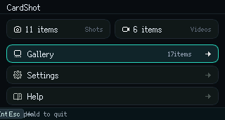
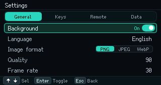
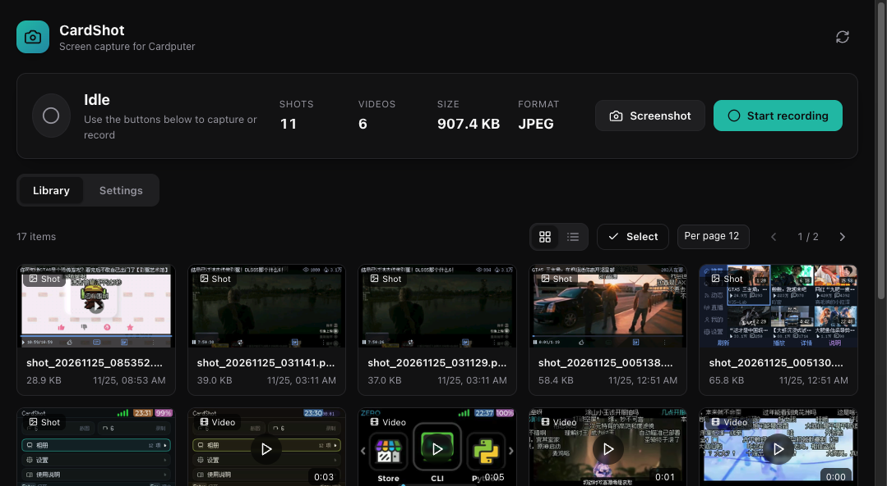

# CardShot

Cardputer Zero 上的截图、录屏与相册管理工具。

由四部分组成：

- `crates/cardshot-core`：抓帧、编码、录制、相册等公共逻辑
- `crates/cardshotd`：后台守护，读取 `/dev/fb0` 抓取当前前台画面，提供截图、录屏、相册、控制 socket 与 HTTP 远程管理
- `crates/cardshot-ui`：设备端管理界面，用于浏览相册、预览、多选删除与设置
- `service/web`：远程 Web 管理页（Preact + htm，无需构建）

## 目录

```
crates/
  cardshot-core/   配置、抓帧、编码、相册、录制
  cardshotd/       守护进程：控制 socket、热键、ACT LED、HTTP 远程
  cardshot-ui/     设备端 Slint 界面
service/
  cardshot.service   systemd 用户服务
  web/              Web 管理页与本地化依赖
reference/          设计原型与调研资料
scripts/            构建、部署与设备脚本
docs/               可行性分析
```

## 构建与部署

```sh
bash scripts/build-rust.sh    # 在 arm64 Debian 容器内构建
bash scripts/deploy-rust.sh   # 上传二进制与 Web 资源，重启 cardshot.service
bash scripts/install-app.sh   # 注册到 APPLaunch
```

产物位于 `crates/target/release/cardshotd` 与 `crates/target/release/cardshot-ui`。

## 使用

- **截图与录制**：`Ctrl+Space` 截图，`Shift+Enter` 切换录制。录制默认静音，可在设置「按键」页开启「录制声音」（内录扬声器输出，最长 2 分钟）
- **设备界面**：主页进入相册；`Enter` 预览、`Space` 多选、`退格` 删除（二次确认）、`Shift+退格` 直接删除、`Esc` 返回；「使用说明」列出全部按键
- **预览**：图片按 320×170 原尺寸显示；视频播放结束后显示播放按钮，`Enter` 或 `空格` 重播；左右切换按钮悬浮在画面上
- **设置**：分为「常规 / 按键 / 远程 / 数据」四页，`Tab` 与 `Shift+Tab` 切换。图片格式、压缩质量、录制帧率按档位调整；服务端口按 `Enter` 输入数字；截图与录制快捷键按 `Enter` 后直接按下组合键保存
- **远程管理**：设备与电脑处于同一局域网时，访问 `http://<设备IP>:<端口>/`，端口见设置页
- **屏幕提示**：截图成功、开始录制、录制已保存会在屏幕顶部短暂显示，不会出现在截图和录像中

## 配置

配置文件默认 `~/.config/cardshot/config.json`，首次运行自动生成。主要项：

- `image_format`：`png` / `jpeg` / `webp`
- `image_quality`：1–100
- `record.fps`、`record.bitrate`、`record.encoder`
- `remote.enabled`、`remote.bind`、`remote.port`
- `hotkeys.enabled`、`hotkeys.shot`、`hotkeys.record`

## 界面预览

设备端：






Web 管理页与设备端共用设置，支持中/英/日三语；相册可切换缩略图与列表、分页、拖拽框选多选；预览支持 1X/2X/3X 像素级缩放，可复制当前倍率图片或下载对应文件。


