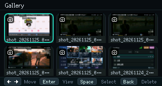
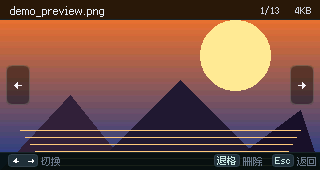

# CardShot

Cardputer Zero（aarch64 Linux，320×170 帧缓冲）上的后台截图 / 录屏 / 相册管理工具。

由三部分组成：

- `rust/cardshotd`：常驻后台守护，读全局 `/dev/fb0` 抓取任意前台应用画面，支持截图、录屏、相册、Unix socket 控制与 HTTP 远程管理
- `rust/cardshot-ui`：设备端界面（Rust + Slint），相册管理工具：浏览、预览、多选删除、设置
- `service/web`：远程 Web 管理页（Preact + htm，无构建步骤）

## 目录

```
rust/
  cardshot-core/   配置、抓帧、编码、相册、录制
  cardshotd/       守护进程：控制 socket、热键、ACT LED、HTTP 远程
  cardshot-ui/     设备端 Slint 界面
service/
  cardshot.service   systemd 用户服务
  config.default.json 默认配置
  web/              Web 管理页与本地化依赖
design/             HTML 设计原型与图标、字体
scripts/            连接设备、构建部署、控制客户端
docs/feasibility.md 可行性分析
```

## 构建

守护与界面均为 aarch64 目标，在 arm64 Debian 容器内构建：

```sh
bash scripts/build-rust.sh
```

产物位于 `rust/target/release/cardshotd` 与 `rust/target/release/cardshot-ui`。

## 部署

```sh
bash scripts/deploy-rust.sh
```

脚本会停止旧服务、上传二进制与 Web 资源、重载并重启 systemd 用户服务 `cardshot.service`。

安装到 APPLaunch（桌面入口与应用图标）：

```sh
bash scripts/install-app.sh
```

## 使用

- 截图/录制：全局热键默认开启（`Shift+Space` 截图、`Shift+Enter` 录制开关），也可在 Web 管理页操作
- 屏幕提示：截图成功、开始录制、录制已保存会在屏幕顶部短暂显示；提示只在帧缓冲上叠加，截图和录像会剔除该区域，成像里看不到提示
- 设备端界面：主页「相册」浏览；`Enter` 预览；`Space` 多选；`退格` 删除（弹窗二次确认）；`Shift+退格` 直接删除；`Esc` 返回；「使用说明」查看完整按键
- 预览页：图片按 320×170 整屏 1:1 显示；视频在预览页循环播放，左右切换不占画面
- 方向键直接使用机身的 `Z C F X`：`Z/C` 左右，`F/X` 上下（与 CardBili 的字母键映射一致）
- 设置页：「常规 / 快捷键 / 远程管理 / 数据」四个分类页，Tab 切换分类；图片格式、压缩质量与录制帧率按预设档位左右切换；远程 Web 开关下方是服务端口，开关关闭时端口灰显；端口按 `Enter` 进入手动数字输入；截图快捷键、录制快捷键按 `Enter` 进入录制，按下组合键即保存
- 远程管理：设备与电脑在同一局域网时访问 `http://<设备IP>:<端口>/`（端口见设置页）

## 配置

配置文件默认 `~/.config/cardshot/config.json`，首次运行会生成。主要项：

- `image_format`：`png` / `jpeg` / `webp`
- `image_quality`：1–100
- `record.fps`、`record.bitrate`、`record.encoder`
- `remote.enabled`、`remote.bind`、`remote.port`
- `hotkeys.enabled`（默认 true）、`hotkeys.shot`、`hotkeys.record`

## 控制接口

Unix socket（`$XDG_RUNTIME_DIR/cardshot.sock`）按行收发 JSON，命令包括：
`status` `shot` `record_start` `record_stop` `record_toggle` `items` `counts` `delete` `config_get` `config_set` `reload` `remote_start` `remote_stop` `remote_status` `thumb`

HTTP API：
`GET /api/status` `/api/items` `/api/config` `/api/thumb?id=` `/api/file?id=&download=1`
`POST /api/shot` `/api/record` `/api/delete` `/api/config` `/api/remote`

## 界面预览

设备端：






远程 Web 管理页：


